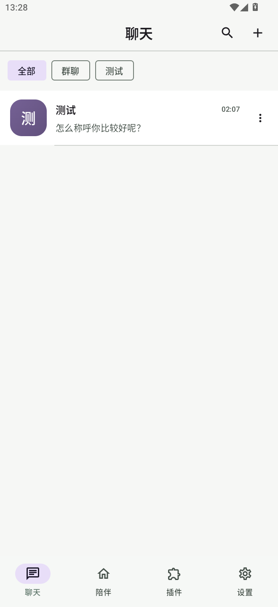
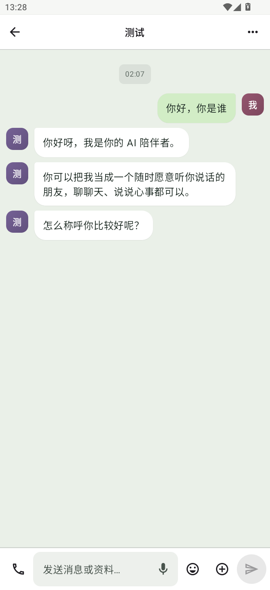

# 微信式聊天主页与时间分隔验收

## 构建

- `./ci/build.ps1`：成功，583 项单元测试通过，失败、错误、跳过均为 0；Release 构建成功。
- APK：`output/local-companion-0.39.0.apk`，SHA-256 `0043CCB1703BCF3891500A200413F0275ACF9D5FF573EB590EE8D44CCAA102DD`。
- `apksigner verify --verbose --print-certs`：签名验证通过，使用 v2 签名。
- `zipalign -c -P 16 4`：16 KB 对齐检查通过。

## MuMu 模拟器

APK 已覆盖安装并启动。竖屏 660×1440、240 dpi 下检查了聊天列表与已有对话。

- 聊天主页显示居中标题、搜索和新建入口、横向筛选、会话头像、最近消息摘要和右侧时间；现有聊天和群聊现在合并并依置顶与最近活动排序。
- 对话中相邻的三条消息共享一条居中时间标签，消息气泡下方不再重复显示时间、发送状态和“…”操作入口。
- 现有消息样例时间相同，因此五分钟间隔和跨日期时新增标签的表现未在设备上观察；逻辑按消息时间构建。
- 未打开输入框，键盘遮挡未检查；Android 真机未连接。

## 截图

