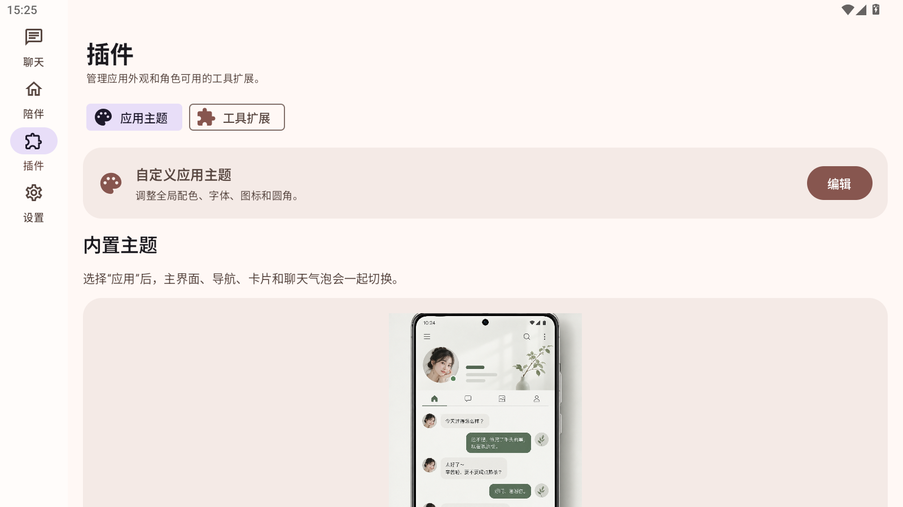
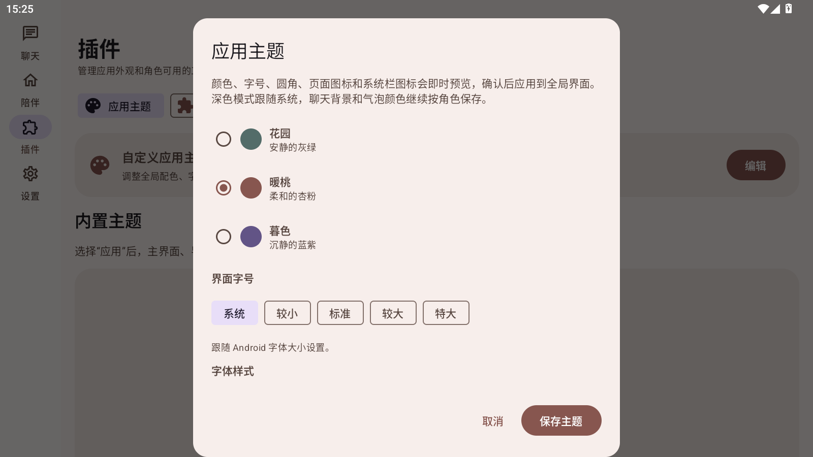
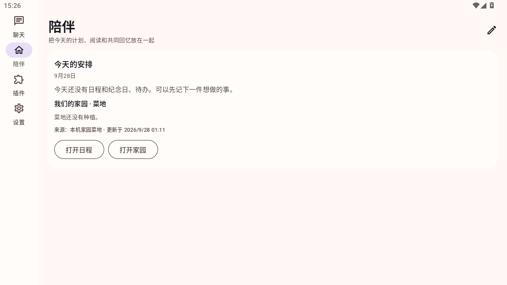
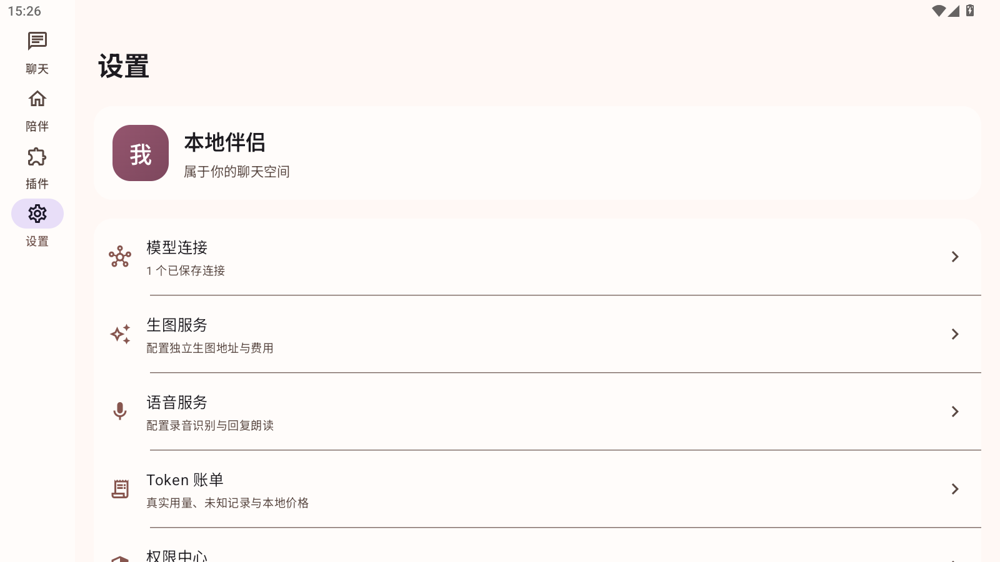

# 应用主题入口验收

## 本次调整

应用主题编辑器的入口统一放到“插件 → 应用主题”。插件页提供“自定义应用主题”卡片打开全局主题编辑器，并保留内置主题快速应用卡片。陪伴页和设置页不再提供重复入口；设置内原有的聊天气泡外观配置仍保留。

## 检查结果

- MuMu 插件页可见“应用主题”分类和“自定义应用主题”编辑卡片。
- 点击“编辑”可打开应用主题编辑器；取消后仍留在插件页。
- 陪伴页不再显示主题调色板入口。
- 设置页不再显示应用主题入口。
- MuMu 安装版本：0.39.0（versionCode 40），包名 `cn.localfirst.companion`。
- `./ci/build.ps1`：583 项单元测试通过，失败 0、错误 0；Release 构建成功。
- APK 签名和 16 KB 对齐校验通过，已安装至 MuMu。
- APK SHA-256：`898080F4B3618160B34A0D8DBB8D6639CFE16E6CE9C22142F31DA5D1957FFCD4`。

## MuMu 截图

### 插件页主题入口

### 主题编辑器

### 陪伴页

### 设置页

