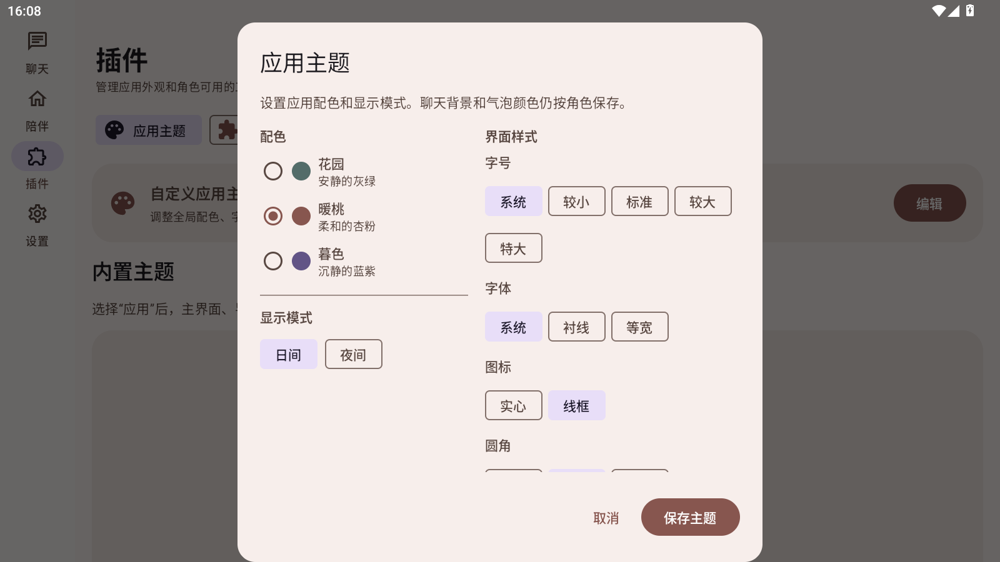
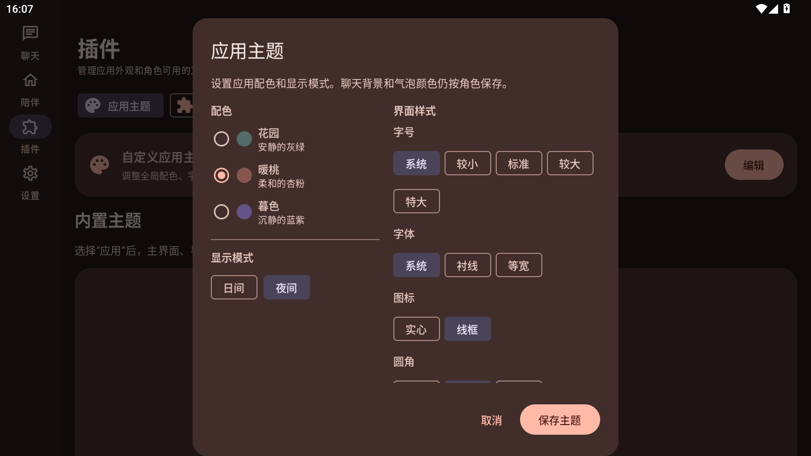
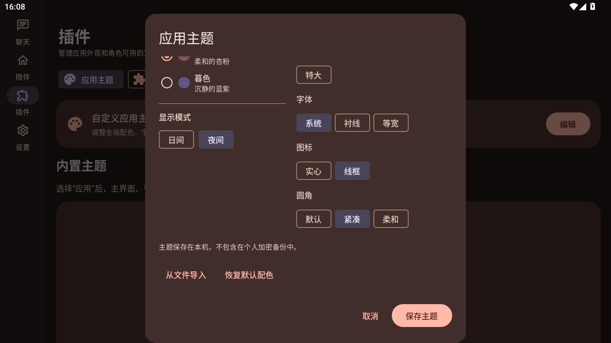

# 主题编辑器改版验收

## 本次改动

- 移除主题页面中的应用界面示例预览，以及手动输入浅色/深色背景色的编辑器。
- 新增日间和夜间显示模式；用户保存的模式保存在本机。
- 宽屏将配色与显示模式放左侧、字号/字体/图标/圆角放右侧；窄屏改成单列。
- 保留主题文件导入和恢复默认配色。

## 检查结果

- MuMu 中主题页面采用左右布局，滚动可到达下方样式选项。
- 分别保存日间和夜间模式，再次打开主题页后均显示对应选择；切换时应用页面颜色同步更新。
- `./ci/build.ps1` 成功：583 项单元测试通过，失败 0、错误 0；Release 构建成功。
- APK v2 签名检查和 16 KB 对齐检查通过；已覆盖安装到 MuMu。
- APK：`output/local-companion-0.39.0.apk`。
- SHA-256：`BA33CACCD1C2D4325DE9374E42D64B4EED0C539F9F355B91207EDD9A3950ACF7`。

## MuMu 截图

### 日间模式

### 夜间模式

### 滚动后的左右布局

