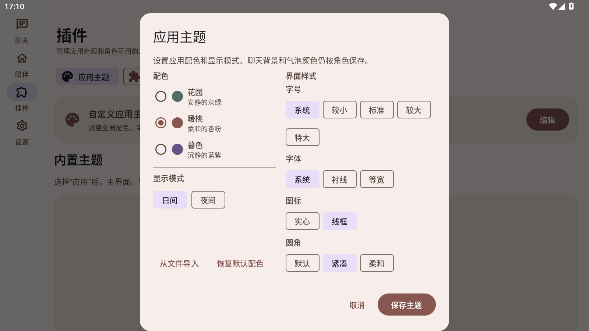

# 主题编辑器按钮对齐验收

## 改动

“从文件导入”和“恢复默认配色”放到宽屏主题编辑器左列的显示模式下方，并与右列“圆角”选项底部对齐。宽屏布局直接测量两列的实际内容高度，确保 FlowRow 最后一组选项和左列操作按钮都参与布局；窄屏仍按纵向顺序显示。

## 验收

- MuMu 横屏安装 `0.39.0` Release APK 并打开“插件 → 应用主题 → 编辑”。
- 显示模式下方可见“从文件导入”和“恢复默认配色”；按钮组与右列圆角选项同一底部基线，圆角选项完整显示。
- Release APK 构建成功，APK v2 签名验证及 16 KB 对齐验证通过，已覆盖安装至 MuMu。
- 首次完整单元测试运行中，`McpSessionTest.redirectNeverReachesCredentialDestination` 收到取消异常；单独重跑通过后，再运行完整套件，583 项通过，失败和错误均为 0。
- APK SHA-256：`3FCBF10D873DA14DE1B5E9208C80D58B9DFFE7BEA07507BBD0F2B2CF19A4997B`。

## 截图

