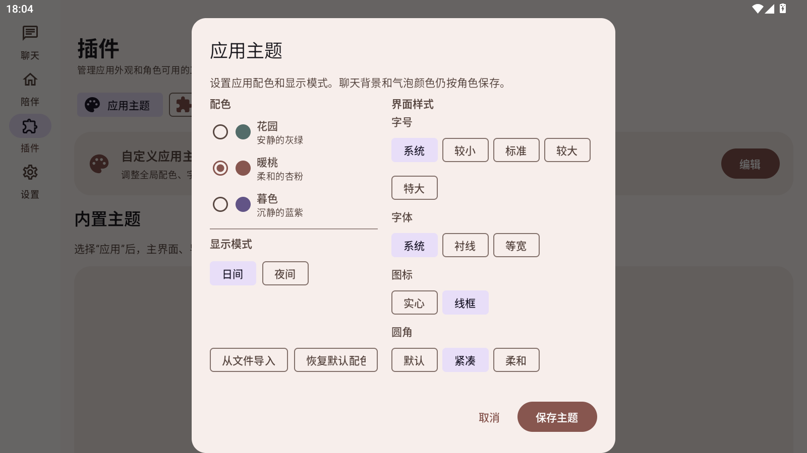

# 主题编辑器选项样式验收

## 调整

已将“从文件导入”和“恢复默认配色”从无边框文字按钮改为 Material SuggestionChip 操作芯片，让它们与字号、字体、图标、圆角等选项使用一致的描边、圆角和高度。它们仍使用按钮操作语义；配色单选列表以及弹窗底部的保存和取消保持原有控件形式。

## 检查

- 已检查主题编辑器的所有控件：配色是单选列表；字号、字体、图标、圆角和日夜模式是选择项；两个文件/恢复操作是操作芯片；保存和取消是弹窗提交/关闭操作。
- MuMu 横屏覆盖安装并打开“插件 → 应用主题 → 编辑”。两个新按钮保持单行，与右侧圆角选择项底部对齐。
- `./ci/build.ps1` 完成 Kotlin 编译，但 583 项完整测试中有 1 项 `McpSessionTest.redirectNeverReachesCredentialDestination` 失败（其余 582 项通过）。单独重跑该测试通过；该测试与主题界面无关。
- `:app:assembleRelease` 构建成功。
- APK v2 签名和 16 KB 对齐校验通过，已覆盖安装到 MuMu。
- APK SHA-256：`D0134FA4FC4E0E1FD788D9B54F28079FCC4E5EF15581B48AC8808BB09F7A156E`。

## 截图

