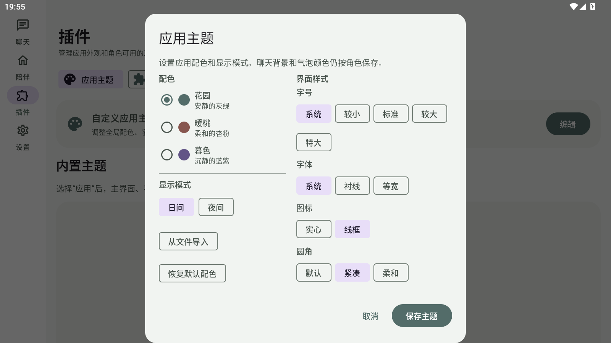

# 主题操作纵向布局验收

## 调整

“从文件导入”和“恢复默认配色”改为上下堆叠，放进显示模式下方原有空白。宽屏下整组操作芯片底部仍与右侧圆角选项底部对齐；窄屏下沿纵向内容顺序显示。

## 验收

- MuMu 横屏安装本次 Release APK，打开“插件 → 应用主题 → 编辑”。
- 两个操作芯片上下排列；显示模式与操作组之间的空白收紧，操作组底边和右侧圆角选项底边对齐。
- Release 构建、APK v2 签名和 16 KB 对齐验证通过，已覆盖安装到 MuMu。
- `ci/build.ps1` 完成：Release 构建和单元测试均通过。
- APK 签名验证、16 KB 对齐验证及 MuMu 覆盖安装通过。
- APK SHA-256：`6EC6C2581854E78CCFF91CE91F40BDCA3CBB3BDEF87491D87BCCCAA1D5604903`。

## 截图

