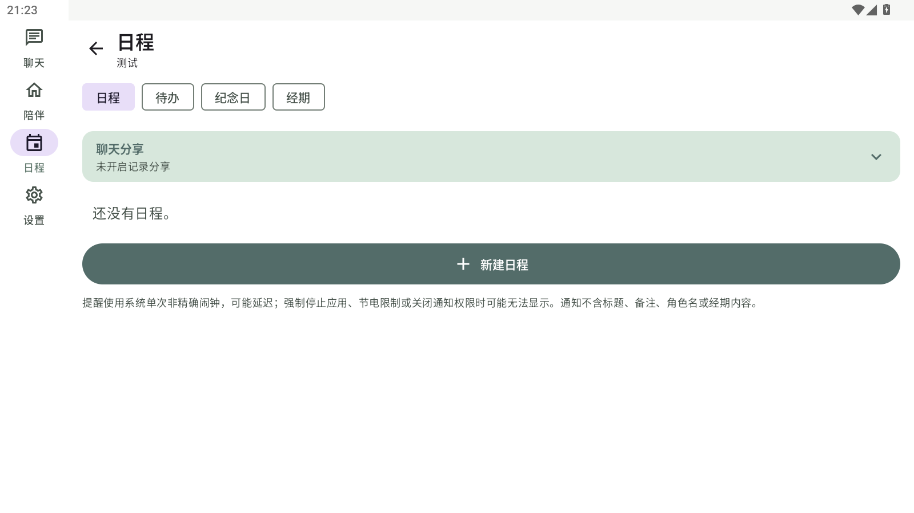
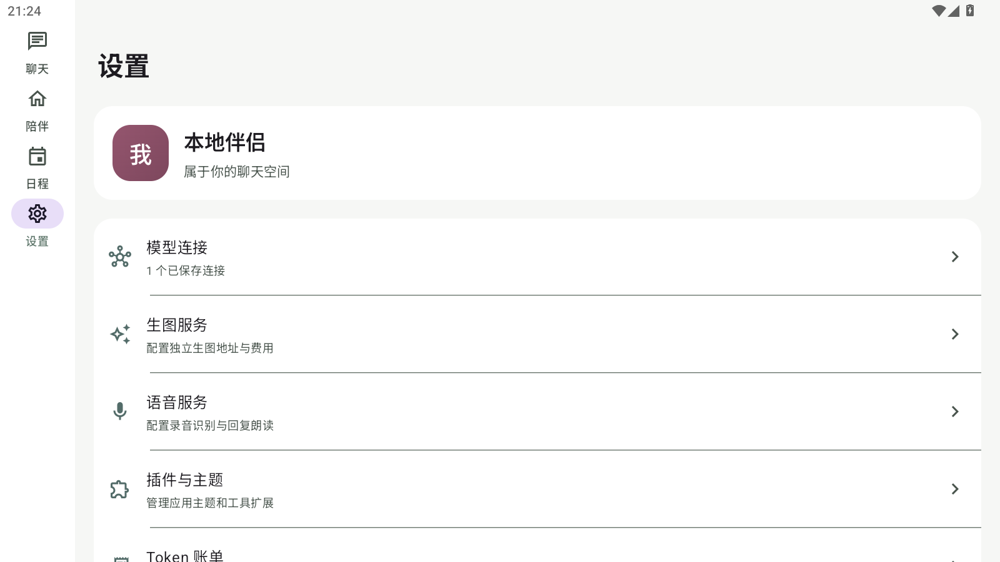

# 主导航调整验收

## 调整

- 底部导航第三个入口改为独立“日程”，展示当前角色的日程、待办、纪念日与经期记录，并允许切换角色。
- 原插件页移入“设置 → 插件与主题”，保留应用主题和工具扩展管理。
- 历史 Dock 设置中的插件/角色入口迁移至日程槽位。

## 验收

- `ci/build.ps1` 完成：单元测试和 Release 构建通过。
- APK v2 签名、16 KB 对齐检查和 MuMu 覆盖安装通过。
- MuMu 已检查导航、日程页面、设置中的插件与主题入口；插件页返回箭头可回到设置。
- 当前模拟器只有一个角色，角色切换菜单和无角色引导未在设备上操作。
- APK SHA-256：`66A4ED2C4E3E1C8367D7E25423BAFDEA3B2370FB82CFCE843DCC503551B9486E`。

## 截图

